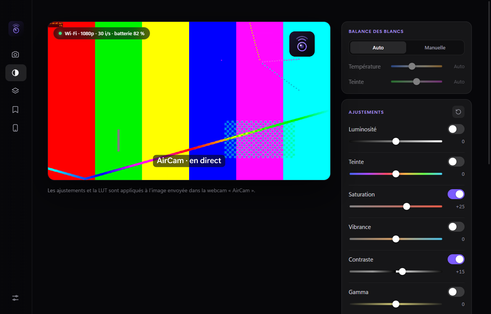
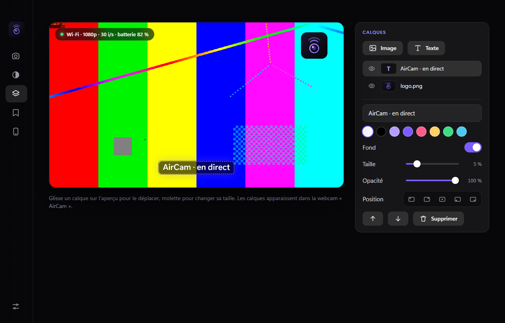
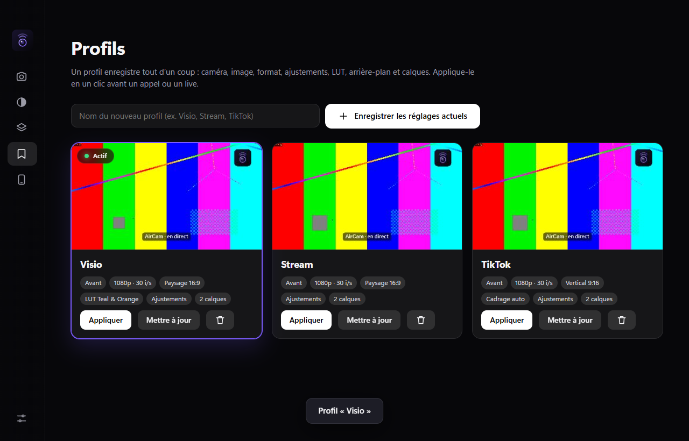

<p align="center">
  
</p>

<h1 align="center">AirCam</h1>

<p align="center">
  La caméra de ton <b>iPhone</b> comme webcam sur <b>Windows</b>, en Wi-Fi ou en USB.<br>
  Une webcam virtuelle « AirCam » pour Zoom, Teams, Discord, OBS, Meet… façon Camo Studio / iVCam, open source et gratuite.
</p>

<p align="center">
  <a href="https://github.com/kf5-io/AirCam/releases/latest"><b>Télécharger</b></a> · <a href="#installation">Installation</a> · <a href="#développement">Développement</a>
</p>


## Fonctionnalités

**Connexion**
- Wi-Fi : l'iPhone est trouvé automatiquement sur le réseau local (Bonjour), sans saisir d'adresse
- USB : plus stable, moins de latence, utilisé en priorité dès que le câble est branché
- Connexion manuelle par adresse IP si la découverte automatique est bloquée
- Flux chiffré (échange de clés X25519 éphémères, AES-256-GCM), sans mot de passe
- Reconnexion automatique (app iPhone relancée, câble rebranché, Wi-Fi qui saute)

**Caméra**
- Caméra avant, arrière, ultra grand-angle et téléobjectif (selon l'iPhone)
- 720p, 1080p ou 4K, en 30, 60 ou 120 i/s (les fréquences que ton iPhone ne sait pas faire sont grisées). Le 4K passe en HEVC (H.265) si le PC sait le décoder ; si l'iPhone n'arrive pas à suivre, il repasse tout seul en 30 i/s
- Format vertical 9:16 pour les lives TikTok / Instagram (l'iPhone filme en portrait, pleine résolution)
- Cadrage automatique façon Center Stage : l'iPhone détecte les visages, le PC recadre en douceur
- Clic sur l'aperçu : mise au point et exposition à cet endroit
- Zoom, exposition, mise au point verrouillable, miroir, retournement à 180°
- Lampe torche de l'iPhone comme lumière d'appoint
- Arrière-plan flou ou remplacé par une image, calculé sur l'iPhone (Vision) : zéro charge pour le PC

**Ajustements et LUT**
- Balance des blancs automatique ou manuelle (température, teinte), réglée directement sur le capteur de l'iPhone
- Luminosité, teinte, saturation, vibrance, contraste, gamma, netteté, chacun activable séparément
- LUT 3D `.cube` (Resolve, Blackmagic Camera…) : bibliothèque avec miniatures, intensité réglable, 5 looks inclus (Chaud, Froid, Noir et blanc, Teal & Orange, Vintage)
- **Apple Log** (iPhone 15 Pro et plus) : plus de dynamique, conversion Apple Log → Rec.709 intégrée ou ta propre LUT log (The One LUT…)
- Rendu sur le GPU du PC (WebGL2), aperçu instantané

**Calques**
- Logos, filigranes (PNG transparents) et textes par-dessus la caméra, visibles dans toutes les applications
- Déplacement à la souris directement sur l'aperçu, taille à la molette, positions rapides (coins, centre)
- Opacité, couleur et fond du texte, visibilité, ordre des calques

**Profils**
- Caméra, format, ajustements, LUT, arrière-plan et calques enregistrés ensemble (« Visio », « Stream », « TikTok »…)
- Une carte par profil avec une miniature et le résumé des réglages, appliquée en un clic

**Webcam virtuelle**
- Apparaît sous le nom « AirCam » dans les applications de visio et de streaming (DirectShow)
- Sortie 720p ou 1080p, paysage ou vertical ; écran « En attente de l'iPhone » quand le téléphone n'est pas là
- Ne consomme rien tant qu'aucune application n'utilise la caméra

**App iPhone**
- Aperçu, état de la connexion, « Écran noir » pour économiser la batterie pendant un appel
- Tous les réglages se font depuis le PC

| Ajustements et LUT | Calques |
|---|---|
|  |  |

| Profils | Appareils |
|---|---|
|  |  |

## Installation

### Sur le PC

1. Télécharge `AirCam-Setup-<version>.exe` dans la [dernière release](https://github.com/kf5-io/AirCam/releases/latest)
2. Lance-le : il demande les droits administrateur pour enregistrer la webcam virtuelle, et crée les raccourcis Bureau et menu Démarrer
3. Autorise AirCam dans le pare-feu Windows si on te le demande (nécessaire pour trouver l'iPhone en Wi-Fi)

L'installeur n'est pas signé : Windows SmartScreen affiche un avertissement au premier lancement (« Informations complémentaires » › « Exécuter quand même »).

Pour l'USB, il faut le service Apple : installe **Apple Devices** (Microsoft Store) ou iTunes.

### Sur l'iPhone

L'app iPhone n'est pas sur l'App Store. Elle est compilée par GitHub Actions (pas besoin de Mac) et s'installe avec un identifiant Apple gratuit :

1. Télécharge `AirCam.ipa` dans la [dernière release](https://github.com/kf5-io/AirCam/releases/latest)
2. Installe-la avec [Sideloadly](https://sideloadly.io), iPhone branché, en te connectant avec ton identifiant Apple
3. Sur l'iPhone : Réglages › Général › VPN et gestion de l'appareil › fais confiance à ton identifiant. Active le mode développeur si iOS le demande (Réglages › Confidentialité et sécurité)
4. Ouvre AirCam, autorise la caméra et le réseau local

> Avec un identifiant Apple gratuit, l'app expire au bout de 7 jours : relance Sideloadly pour la réinstaller. Un compte développeur payant la signe pour 1 an.

Garde l'app ouverte au premier plan : iOS coupe la caméra des apps en arrière-plan. iOS 16 minimum (iOS 17 pour l'Apple Log).

### Utilisation

Ouvre AirCam sur le PC et sur l'iPhone : la connexion est automatique. Dans Zoom, Teams, Discord, OBS…, choisis la caméra **AirCam**. Les applications déjà ouvertes doivent être relancées pour voir une caméra fraîchement installée ou un changement de format.

## Développement

```sh
npm install
npm run get-softcam   # télécharge les webcams virtuelles compilées par le CI dans vendor/ (une fois)
npm start             # lance l'app
npm test              # tests unitaires (protocole, chiffrement, H.264, LUT, Apple Log, cadrage)
npm run dist          # installeur Windows dans dist/
```

Prérequis : Node.js 20+, Windows 10/11. En développement, clique sur **Installer** (Caméra ou Réglages) pour enregistrer la webcam virtuelle : Windows demande l'autorisation administrateur une fois.

L'app iPhone (`ios/`) se génère avec [XcodeGen](https://github.com/yonaskolb/XcodeGen) : `cd ios && xcodegen generate`, puis ouvre `AirCam.xcodeproj` sur un Mac. Sans Mac, chaque push sur `ios/` lance le workflow **ios**, qui produit l'IPA non signée (et l'attache à la release pour un tag `v*`).

## Architecture

```
src/
  main.js              process principal : fenêtre, découverte Bonjour + USB, connexion, LUT, profils, installation de la webcam
  preload.js           API exposée à l'interface + sortie webcam virtuelle (softcam.dll via koffi)
  protocol.js          protocole réseau partagé avec l'iPhone
  secure.js            chiffrement du flux (X25519 + AES-256-GCM)
  usbmux.js            tunnel TCP vers l'iPhone par le câble (service Apple Mobile Device)
  renderer/
    index.html, app.js, style.css   l'interface (vanilla JS, sans framework, même design que KF Player)
    video.js                         fonctions pures : SPS H.264, LUT .cube, courbe Apple Log, looks, cadrage
    grade.js                         étalonnage GPU (WebGL2) : netteté, LUT 3D, ajustements
ios/
  project.yml          projet XcodeGen
  AirCam/              app SwiftUI : capture, visages, segmentation, encodage, serveur chiffré
  Tests/main.swift     vérifie que le chiffrement iPhone et PC produisent les mêmes octets (CI)
native/mfcam/          caméra Media Foundation pour Windows 11 (expérimentale, voir son README)
build/installer.nsh    enregistrement de la webcam virtuelle à l'installation
scripts/get-softcam.js télécharge les DLL compilées par le CI
.github/workflows/     softcam.yml (webcam DirectShow), mfcam.yml (webcam Media Foundation), ios.yml (IPA)
test/                  tests unitaires (node --test)
```

**Le flux vidéo** : l'iPhone capture (AVFoundation), applique le flou ou le remplacement d'arrière-plan (Vision + Core Image), encode en H.264 matériel, ou HEVC en 4K (VideoToolbox, sans B-frames pour la latence) et sert le flux en TCP sur le port 47800, annoncé en Bonjour (`_aircam._tcp`). En USB, le PC atteint le même port par usbmux. Le PC décode avec WebCodecs (décodage matériel de Chromium), applique recadrage, étalonnage et calques dans un canvas, et pousse les images dans la webcam virtuelle.

**Le chiffrement** (`src/secure.js`, `ios/AirCam/Secure.swift`) : à chaque connexion, le PC et l'iPhone échangent une clé X25519 éphémère, en dérivent deux clés AES-256 (HKDF-SHA256), puis chaque message voyage dans un enregistrement AES-256-GCM `[longueur u32][chiffré + tag]` avec un compteur par sens (anti-rejeu). Pas de mot de passe : le flux est illisible pour qui l'écoute, mais aucun appairage n'empêche un autre appareil du réseau de se connecter.

**Le protocole** : messages `[type u8][longueur u32 big-endian][données]`. iPhone → PC : vidéo (`0x01`, octet de drapeaux bit 0 image clé / bit 1 HEVC, Annex B avec les paramètres à chaque image clé), état JSON (`0x02`), visages détectés (`0x03`). PC → iPhone : réglages JSON (`0x10`), image d'arrière-plan (`0x11`), demande d'image clé (`0x12`), point de mise au point (`0x13`). En cas de congestion Wi-Fi, l'iPhone jette les images intermédiaires plutôt que d'accumuler du retard, puis renvoie une image clé.

**La webcam virtuelle** est [softcam](https://github.com/tshino/softcam) (MIT), un filtre DirectShow. Le workflow **softcam** la compile et la renomme « AirCam » (nom, CLSID et mémoire partagée propres, pour ne pas entrer en conflit avec d'autres apps basées sur softcam). Elle est en 64 bits : les rares applications 32 bits ne la voient pas. Elle n'apparaît pas dans l'app Caméra de Windows ni dans les apps du Store (Media Foundation uniquement) : une caméra Media Foundation pour Windows 11 est en cours (`native/mfcam`, expérimentale, pas installée).

## Licence

[MIT](LICENSE). softcam : MIT, © tshino. VCamSample (base de la caméra Media Foundation) : MIT, © Simon Mourier.
