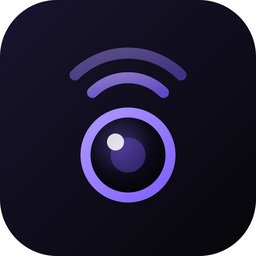
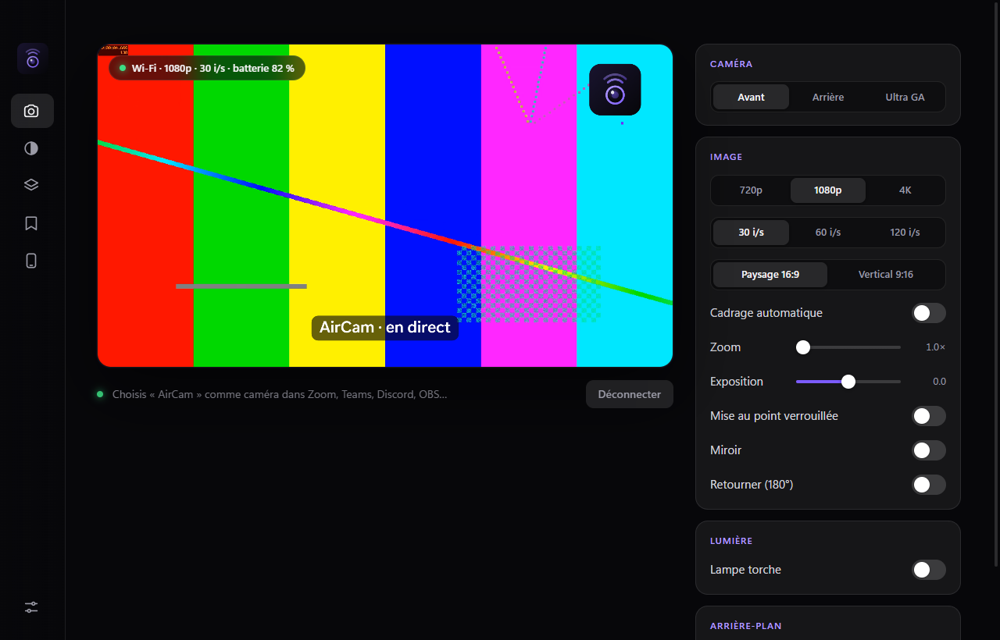
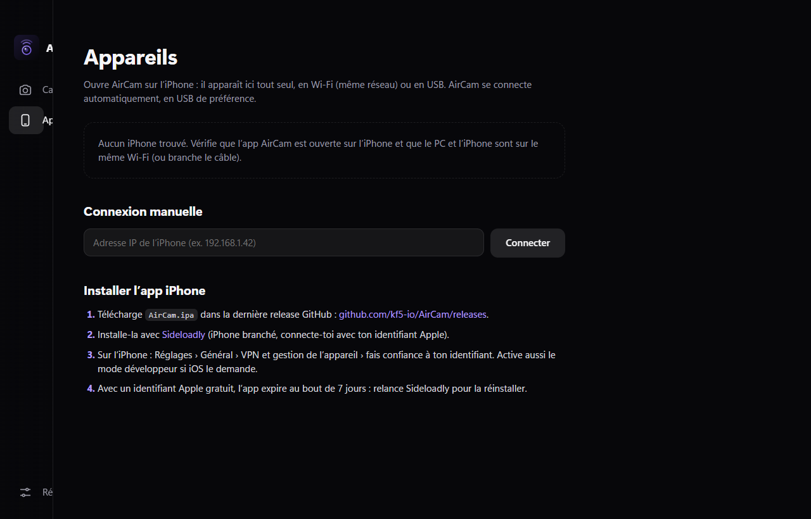

<p align="center">
  
</p>

<h1 align="center">AirCam</h1>

<p align="center">
  La caméra de ton <b>iPhone</b> comme webcam sur <b>Windows</b>, en Wi-Fi ou en USB.<br>
  Une webcam virtuelle « AirCam » utilisable dans Zoom, Teams, Discord, OBS, Meet… façon Camo Studio / iVCam, open source et gratuit.
</p>



## Fonctionnalités

**Connexion**
- Wi-Fi : l'iPhone est trouvé automatiquement sur le réseau local (Bonjour), sans saisir d'adresse
- USB : plus stable, moins de latence, utilisé en priorité dès que le câble est branché
- Connexion manuelle par adresse IP si la découverte automatique est bloquée
- Reconnexion automatique (app iPhone relancée, câble rebranché, Wi-Fi qui saute)

**Image**
- Caméra avant, arrière, ultra grand-angle et téléobjectif (selon l'iPhone)
- 720p, 1080p ou 4K, en 30 ou 60 i/s
- Zoom, exposition, mise au point verrouillable
- Miroir et retournement à 180° (iPhone posé dans l'autre sens)
- Lampe torche de l'iPhone comme lumière d'appoint

**Ajustements et LUT**
- Balance des blancs automatique ou manuelle (température, teinte), réglée directement sur le capteur de l'iPhone
- Luminosité, teinte, saturation, vibrance, contraste, gamma, netteté, chacun activable séparément
- LUT 3D `.cube` (Resolve, Blackmagic Camera…) : bibliothèque avec miniatures, intensité réglable, 5 looks inclus (Chaud, Froid, Noir et blanc, Teal & Orange, Vintage)
- **Apple Log** (iPhone 15 Pro et plus) : plus de dynamique, conversion Apple Log → Rec.709 intégrée ou ta propre LUT log (The One LUT…)
- Rendu sur le GPU du PC (WebGL2), aperçu instantané

**Arrière-plan**
- Flou ou remplacement par une image, calculé sur l'iPhone (Vision, segmentation de personne) : zéro charge pour le PC

**Calques**
- Logos, filigranes (PNG transparents) et textes par-dessus la caméra, visibles dans toutes les applications
- Déplacement à la souris directement sur l'aperçu, taille à la molette, positions rapides (coins, centre)
- Opacité, couleur et fond du texte, visibilité, ordre des calques ; tout est mémorisé

**Webcam virtuelle**
- Apparaît sous le nom « AirCam » dans toutes les applications compatibles DirectShow
- Sortie en 720p ou 1080p ; écran « En attente de l'iPhone » quand le téléphone n'est pas connecté
- Ne consomme rien tant qu'aucune application n'utilise la caméra

**App iPhone**
- Aperçu, état de la connexion, « Écran noir » pour économiser la batterie pendant un appel
- Tous les réglages se font depuis le PC

| Appareils |
|---|
|  |

## Installation

### Sur le PC

Télécharge `AirCam-Setup-<version>.exe` dans les [releases](https://github.com/kf5-io/AirCam/releases), ou construis-le :

```sh
npm install
npm run dist
```

Résultat : `dist/AirCam-Setup-<version>.exe`. L'installeur demande les droits administrateur pour enregistrer la webcam virtuelle, et crée les raccourcis Bureau et menu Démarrer.

L'installeur n'est pas signé : Windows SmartScreen affiche un avertissement au premier lancement (« Informations complémentaires » › « Exécuter quand même »).

Pour l'USB, il faut le service Apple : installe **Apple Devices** (Microsoft Store) ou iTunes.

### Sur l'iPhone

L'app iPhone n'est pas sur l'App Store. Elle se compile sur GitHub Actions (pas besoin de Mac) et s'installe avec un identifiant Apple gratuit :

1. Télécharge `AirCam.ipa` dans les [releases](https://github.com/kf5-io/AirCam/releases) (ou dans les artefacts du workflow **ios**)
2. Installe-la avec [Sideloadly](https://sideloadly.io), iPhone branché, en te connectant avec ton identifiant Apple
3. Sur l'iPhone : Réglages › Général › VPN et gestion de l'appareil › fais confiance à ton identifiant. Active le mode développeur si iOS le demande
4. Ouvre AirCam, autorise la caméra et le réseau local

> Avec un identifiant Apple gratuit, l'app expire au bout de 7 jours : relance Sideloadly pour la réinstaller. Un compte développeur payant la signe pour 1 an.

Garde l'app ouverte au premier plan : iOS coupe la caméra des apps en arrière-plan.

## Développement

```sh
npm install
npm run get-softcam   # télécharge la DLL de la webcam virtuelle dans vendor/softcam (une fois)
npm start             # lance l'app
npm test              # tests unitaires (protocole, parsing H.264, conversion d'image, LUT, Apple Log)
```

Prérequis : Node.js 20+, Windows 10/11. En développement, clique sur **Installer** (Caméra ou Réglages) pour enregistrer la webcam virtuelle : Windows demande l'autorisation administrateur une fois.

L'app iPhone (`ios/`) se génère avec [XcodeGen](https://github.com/yonaskolb/XcodeGen) : `cd ios && xcodegen generate`, puis ouvre `AirCam.xcodeproj` sur un Mac. Sans Mac, chaque push sur `ios/` lance le workflow **ios**, qui produit l'IPA non signée.

## Architecture

```
src/
  main.js              process principal : fenêtre, découverte Bonjour + USB, connexion à l'iPhone, installation de la webcam
  preload.js           API exposée à l'interface + webcam virtuelle (softcam.dll via koffi)
  protocol.js          protocole réseau partagé avec l'iPhone
  usbmux.js            tunnel TCP vers l'iPhone par le câble (service Apple Mobile Device)
  renderer/
    index.html, app.js, style.css   l'interface (vanilla JS, sans framework, même design que KF Player)
    video.js                         fonctions pures : SPS H.264, RGBA → BGR, LUT .cube, courbe Apple Log, looks
    grade.js                         étalonnage GPU (WebGL2) : netteté, LUT 3D, ajustements
ios/
  project.yml          projet XcodeGen
  AirCam/              app SwiftUI : capture, segmentation, encodage, serveur
build/installer.nsh    enregistrement de la webcam virtuelle à l'installation
scripts/get-softcam.js télécharge la DLL compilée par le CI
.github/workflows/     softcam.yml (DLL de la webcam), ios.yml (IPA)
test/                  tests unitaires (node --test)
```

**Le flux vidéo** : l'iPhone capture (AVFoundation), applique le flou ou le remplacement d'arrière-plan (Vision + Core Image), encode en H.264 matériel (VideoToolbox, sans B-frames pour la latence) et sert le flux en TCP sur le port 47800, annoncé en Bonjour (`_aircam._tcp`). En USB, le PC atteint le même port par usbmux. Le PC décode avec WebCodecs (décodage matériel de Chromium), dessine dans un canvas (aperçu, miroir, rotation) et pousse les images dans la webcam virtuelle.

**Le protocole** : messages `[type u8][longueur u32 big-endian][données]`. iPhone → PC : vidéo (`0x01`, Annex B avec SPS/PPS à chaque image clé), état JSON (`0x02`). PC → iPhone : réglages JSON (`0x10`), image d'arrière-plan (`0x11`), demande d'image clé (`0x12`). En cas de congestion Wi-Fi, l'iPhone jette les images intermédiaires plutôt que d'accumuler du retard, puis renvoie une image clé.

**La webcam virtuelle** est [softcam](https://github.com/tshino/softcam) (MIT), un filtre DirectShow. Le workflow **softcam** la compile et la renomme « AirCam » (nom, CLSID et mémoire partagée propres, pour ne pas entrer en conflit avec d'autres apps basées sur softcam). Elle est en 64 bits : les rares applications 32 bits ne la voient pas.

## Licence

[MIT](LICENSE). softcam : MIT, © tshino.
